---

### Обо мне

Студент университета «Сириус». Также учусь в Финансовом университете, направление «Прикладные информационные системы в экономике и финансах».

**Сферы интересов:** агенты, ИИ-системы, финтех, ML, автоматизация бизнес-процессов.

---

### Проекты

Каждый проект на [сайте-резюме](https://ivanshehav.github.io) открывается в мини-окне с коротким описанием и демо.

| Проект | О чем | Демо |
| --- | --- | --- |
| Виртуальный пациент | Симулятор клинического мышления: студент-медик говорит с LLM в роли пациента. Тимлид и аналитик | [открыть](https://ivanshehav.github.io/#p-patient) |
| Тренажер диспетчера 112 | Рабочее место, где новичок учится принимать решения по вызовам. Хакатон ЛЦТ 2026 | [открыть](https://ivanshehav.github.io/#p-dispatcher) |
| Аудит привлечения клиентов в Альфа-Бизнес | Конкурс «Альфа-Будущее»: консалтинговый кейс про привлечение новых клиентов | [открыть](https://ivanshehav.github.io/#p-alfa) |
| Telegram-бот для бизнеса | Бот поддержки для покупателей маркетплейсов | [открыть](https://ivanshehav.github.io/#p-kiroden) |
| Автоматизированная онбординг-платформа | Сайт, который за пару часов проводит нового сотрудника от анкеты до выданных доступов | [открыть](https://ivanshehav.github.io/#p-onboarding) |
| Защищенная IT-инфраструктура | Сервера и сеть из четырех VLAN на Astra Linux, VMmanager и MikroTik | [открыть](https://ivanshehav.github.io/#p-infra) |
| 3D-моделирование | Поезда, мост, тоннель и депо для VR-симулятора, деталь в KOMPAS-3D («Хайтек. Юниоры») | [открыть](https://ivanshehav.github.io/#p-vr3d) |

---

### Стек

**Продукт и аналитика**

**AI и данные**

**Разработка и инфраструктура**

**3D и инженерная графика**

---

### Открытые репозитории

- [finance_tracker](https://github.com/IvanShehav/finance_tracker): финансовый трекер на C++ с графиками и рынками
- [Agents_system_for_YandexHack](https://github.com/IvanShehav/Agents_system_for_YandexHack): мультиагентная система, которая оценивает заявку на IT-проект и пишет технический план
- [development-of-neural-networks](https://github.com/IvanShehav/development-of-neural-networks): нейросети
- [vector_editor-pet-project-](https://github.com/IvanShehav/vector_editor-pet-project-): векторный редактор
- [OnlineBank-on-Bash](https://github.com/IvanShehav/OnlineBank-on-Bash): учебный банк на Bash
- [3D_Models](https://github.com/IvanShehav/3D_Models) и [Design_portfolio](https://github.com/IvanShehav/Design_portfolio): 3D и дизайн

Командные проекты хакатона и стажировки лежат в репозиториях команд. Приватный код показываю по запросу.
